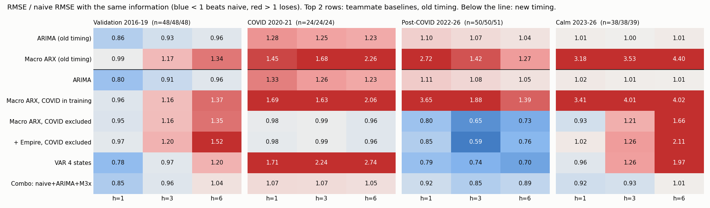

# New York State Unemployment Forecasting

**Can economic indicators and alternative data beat a "no change" forecast of the New York State unemployment rate?**

This project forecasts the monthly NY unemployment rate (FRED `NYUR`) 1, 3 and 6 months ahead. It compares classical time series models and machine learning against a naive baseline in a strict pseudo-real-time backtest, and puts the results in an interactive Streamlit dashboard with a Claude-powered assistant.



## Key results

- **Indicators help when the labor market is turning.** During the 2022 post-COVID decline, an ARX model (NY jobless claims, NY payrolls, US unemployment) and a VAR of NY/NJ/CT/PA unemployment rates cut 3-month forecast RMSE by **about 25–35% versus naive**.
- **They don't help in calm periods.** From 2023 on, most models turn noise into trends, and at 6 months nothing reliably beats "no change".
- **A combination model shrunk toward naive (`combo_s`) is the most robust.** It never loses badly, and it is the only model that beats naive with statistical significance (1-month horizon, post-COVID, Diebold-Mariano p = 0.02).
- **Machine learning gives similar gains, not a breakthrough.** The validation-selected models (Ridge with regional features at h = 1/3, Gradient Boosting at h = 6) reached **0.76 / 0.68 / 0.83× naive RMSE** post-COVID. They did not beat the best time series models across the board.
- **No model anticipated COVID.** Shock-period errors were about as large as naive or worse.

Post-COVID RMSE relative to naive (below 1 = better than naive):

| Model | h = 1 | h = 3 | h = 6 |
|---|---|---|---|
| naive RMSE (pp) | 0.206 | 0.385 | 0.763 |
| ARIMA(0,1,2) | 1.12 | 1.08 | 1.05 |
| ARX (claims, payrolls, US UR) | 0.80 | 0.66 | 0.73 |
| VAR(3), neighboring states, shrunk | 0.74 | 0.66 | 0.79 |
| **Combination, shrunk (recommended)** | **0.92** | **0.88** | **0.99** |
| ML: validation-selected (Ridge / GBM) | 0.76 | 0.68 | 0.83 |

## Data

A reproducible pipeline builds a monthly panel from 1976 onward ([`src/data/`](src/data/)):

- **FRED:** NY, US and neighboring-state (NJ, CT, PA) unemployment rates, NY and US initial jobless claims, NY nonfarm payrolls, the Philly Fed NY coincident index, the 10y–3m Treasury spread, the fed funds rate, and the NY Fed Empire State Manufacturing Survey
- **Yahoo Finance:** S&P 500
- **Indeed Hiring Lab:** NY job postings index (from 2020)
- **NY Open Data:** quarterly statewide taxable sales

NY weekly claims are not seasonally adjusted and have holiday spikes, so they are averaged by month and seasonally adjusted with STL.

## Methods

**Pseudo-real-time backtest.** Each forecast uses only data that had been published by the forecast date. Release dates come from a BLS/DOL release calendar. Seasonal adjustment is re-estimated at every origin, so it never looks ahead. Models are refit on an expanding window, and multi-step forecasts use the direct method (a separate model per horizon, with no future regressor values).

**Splits.** Train 1990–2015, validation 2016–2019 (used for every model choice), then the COVID test (2020–2021) and the post-COVID test (2022–Aug 2026). All settings were frozen before scoring the test periods.

**Models**
- Naive (latest published rate) and ARIMA
- ARX: a direct regression on claims, payroll growth and US unemployment, with COVID months dropped from training
- VAR(3) on monthly changes of NY, NJ, CT and PA unemployment rates
- Shrinkage toward naive, `naive + λ·(model − naive)`, with λ chosen per horizon on validation
- Machine learning: Ridge, Lasso, Random Forest and Gradient Boosting, with scaling and tuning inside each training window

**Evaluation.** RMSE and MAE relative to naive, scored on targets that every model forecast. Diebold-Mariano tests (HLN-corrected) check significance, and empirical 95% intervals are built from backtest errors.

## Dashboard and AI assistant

A Streamlit + Plotly app in [`app/`](app/) shows the live forecasts with intervals, the backtests, the model scorecard and the indicators. Its **Ask the forecast** panel is a Claude assistant grounded in the project's results.

```bash
pip install -r requirements.txt
streamlit run app/app.py
```

The app runs offline from committed outputs. The assistant needs `ANTHROPIC_API_KEY` in `.env`; without it, the panel shows a preview conversation.

## Repository layout

| Path | Contents |
|---|---|
| `src/data/` | Data fetching and panel building |
| `data/processed/` | Monthly panel, quarterly taxable sales, data dictionary |
| `modeling/` | Pseudo-real-time framework, experiments, ML models and tests |
| `results/` | Final forecasts, metrics and scorecard |
| `app/` | Streamlit dashboard and assistant |
| `docs/` | Detailed write-ups: [time series models](docs/STEP2_HANDOFF.md), [ML and validation](docs/STEP3_HANDOFF.md), [data and modeling notes](docs/DATA_AND_MODELING_NOTES.md) |

## Limitations

- The data is today's revised data, not the values originally published (no ALFRED vintages).
- The 2020–2026 test periods were inspected during development, so the clean test is prospective: score the frozen models on each new month.
- Samples are small (about 50 post-COVID targets per horizon), so rankings are suggestive rather than conclusive.

## Team

Group project by Richard Wen, Mo Ali and Xiangyi Kong. Originally developed at [moali-26/nys-unemployment-forecast](https://github.com/moali-26/nys-unemployment-forecast).
